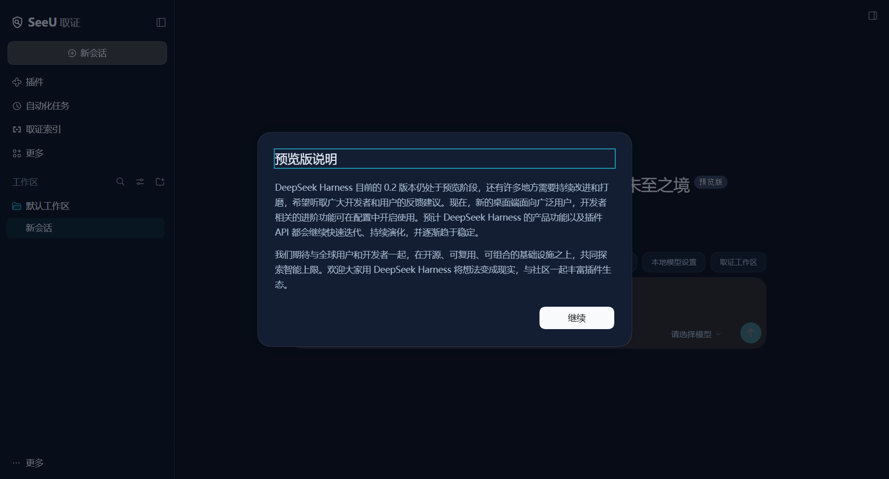
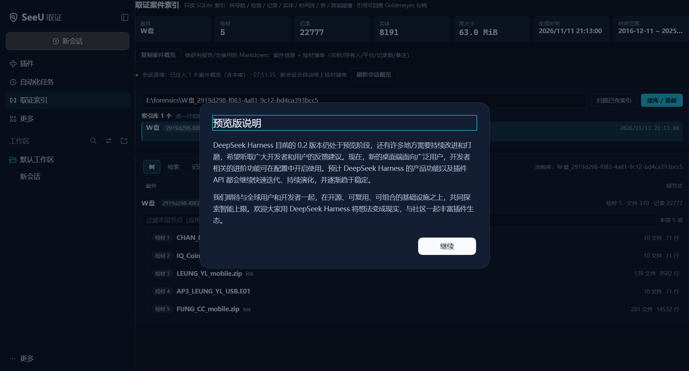
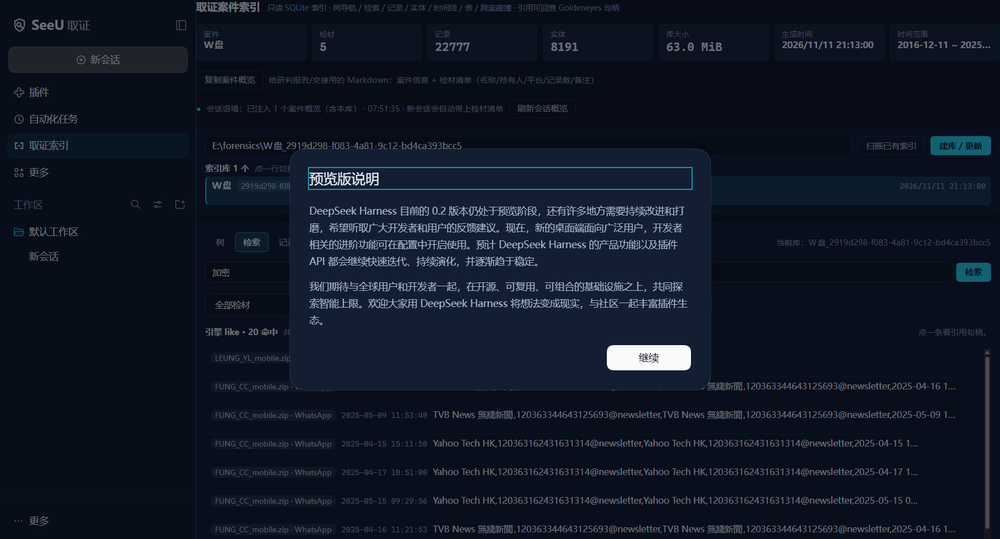
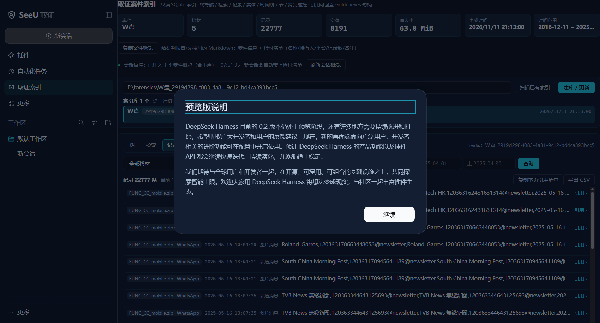
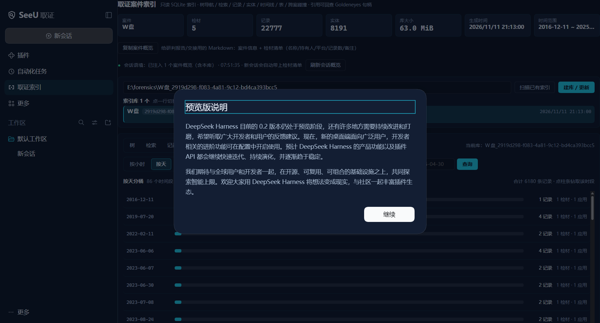
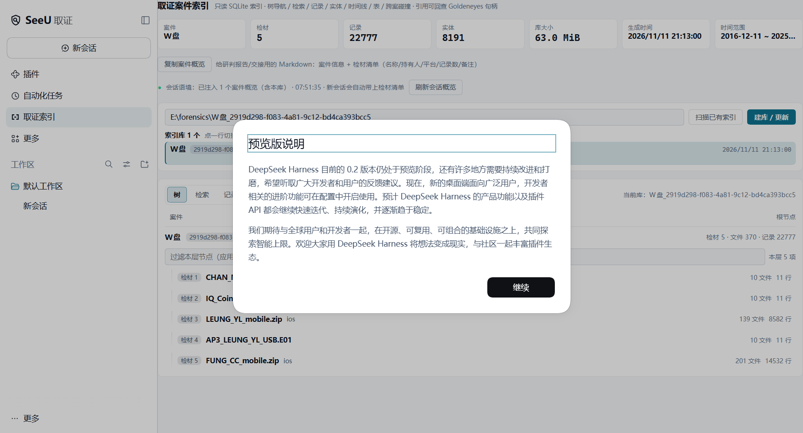
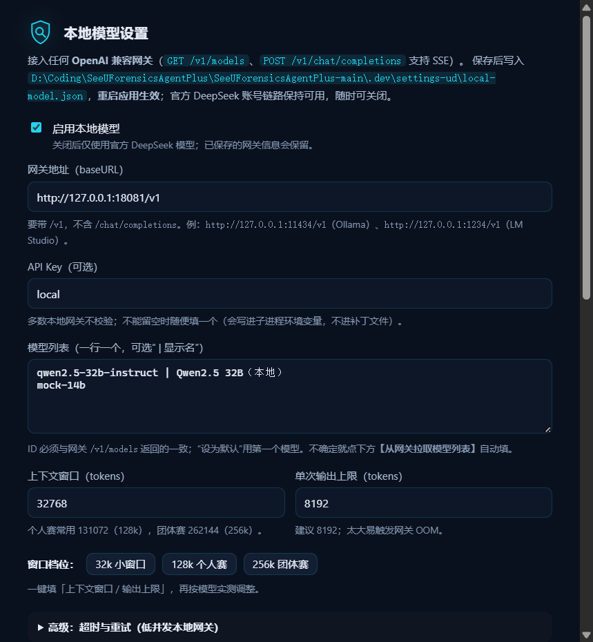
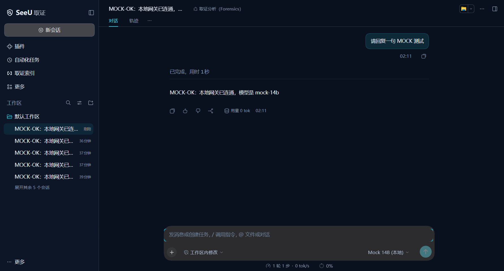
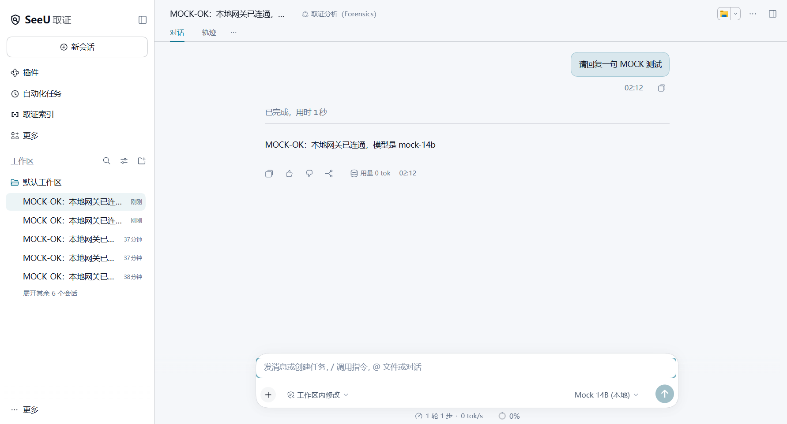

# 验收清单（v0.2.7 包 / 当前 dev 预览）

> 目标：用 10 分钟确认「前端界面 + 本地模型适配」这轮改造成果符合预期。
> 三种方式任选：① 双击 `release/SeeUForensicsAgentPlus-0.2.7-x64-portable.exe`；② 打开 dev 预览（需向我要当前 token）；③ 先看下面的截图，再决定要不要装。

## 一、看截图（最快）

| 界面 | 截图 | 这轮该看什么 |
| --- | --- | --- |
| 欢迎页 |  | 三个快捷入口（打开索引面板 / 本地模型设置 / 选择工作区）、下方「最近案件」chip 与「本地模型：<模型名> · <窗口> · 网关可用/不可用」chip |
| 索引面板 · 树 |  | KPI 条（案件/检材/记录/实体/库大小/生成时间/时间范围）、「● 会话语境：已注入 N 个案件概览」+【刷新会话概览】、树里检材显示火眼名称与备注、本层过滤框 |
| 索引面板 · 检索 |  | 命中词黄色高亮、结果行「检材名 · 应用 / 时间 / 片段」、分页「共 N 条 · 第 a–b 条」、【复制引用清单】【导出全部】【导出 CSV】、筛选行（检材下拉 / 应用 / 起止日期） |
| 索引面板 · 记录 |  | 检材下拉 + 应用 + 类别 + 关键词 + 起止日期、结果行检材名、【复制本页引用清单】【导出 CSV】、翻页 |
| 索引面板 · 时间线 |  | 按小时/天/月分桶、检材与应筛选都是下拉、点柱条钻取、【复制时间线清单】 |
| 索引面板 · 浅色 |  | 系统切浅色后，面板配色跟随（底色 `rgb(245,247,250)`、文字深色），无硬编码暗色残留 |
| 本地模型设置 |  | 网关/模型/窗口/输出、档位按钮、【从网关拉取模型列表】【测试连接】【预热模型】、固定开销估算、健康度提示、高级区、复制诊断、保存并重启 |
| 会话区（暗 / 浅） |   | 用户气泡、正文行高、代码块、输入框聚焦光晕在两套主题下都正常 |

截图由 `node scripts/e2e/acceptance-shots.mjs`（前 6 张，真实案件库）和 `settings-check.mjs --out`（设置页）自动生成，可随时重跑。

## 二、动手验收（10 分钟）

1. **启动**：双击 portable 版（或装 NSIS 版），等界面出来；`release/` 里旧版 `0.1.7` 可以先不管。
2. **欢迎页**：确认三个入口和一个「最近案件」chip 能点（点了应直接进索引面板 / 本地模型设置）。
3. **索引面板**：侧栏点「取证索引」→ 应自动带出上次的案件目录（E 盘那个 W 盘案件）→ 树里能看到 5 个检材的真实名称；切「检索」输「加密」回车，看高亮、翻页、点一行看引用句柄。
4. **导出**：记录视图点【导出 CSV】，应弹「已导出 N 行…到 <下载>/seeu-exports」；打开那个 CSV 用 Excel 看中文是否乱码（应正常）。
5. **本地模型设置**：右上角打开（或欢迎页第二个 chip）→ 看「固定开销估算」是否显示约 `6.6k tokens`；点【测试连接】按你的网关配置。
6. **深浅色**：Windows 设置里切换「应用模式」为浅色，重启应用，看加载页 / 设置页 / 面板是否都变浅色。

发现问题请直接截图 + 一句话描述（哪个界面、点了什么、期望什么、实际什么）。

## 三、本地模型真机联调（需要你提供）

现在只用 mock 网关验过协议，真机还没跑过。请给我：

- **baseURL**（例如 `http://127.0.0.1:11434/v1`、`http://127.0.0.1:1234/v1`、`http://<服务器>:8000/v1`）；
- **模型 id**（如 `qwen2.5-14b-instruct`、`llama-3.1-8b`）；
- **apiKey**（本地网关一般随便填，或告诉我用哪个环境变量）；
- 可选：显存/并发（单请求还是能并发）、上下文窗口（不确定就留空，我会探测 `/v1/models` 自报值）。

我会做的事：`/v1/models` 探测 + 一次最小对话 + 工具调用（走精简预设 12 个工具）+ 上下文窗口核对 + 一轮真实会话（发一句话，看首 token 延迟、用量显示、出错时中文提示），然后把结果和调优建议发给你。

## 四、当前已自动验证（可作为参考）

- `npm test`：**55/55** 纯函数单测（CSV、facets、分页、窗口估算、网关错误翻译、精简预设、标题开关、流式用量…）；
- `scripts/e2e/`：**17 个**端到端脚本（面板、检索筛选/分页/高亮/导出、记录/表/实体/时间线导出、案件概览、跨案双案件、设置页、预热、深浅色、欢迎页 chip、会话排版）；
- 打包态回归（v0.2.7）：`m2-ui-check` / `settings-check` / `export-check` / `cross-case-check` 全绿，详见 `docs/packaging.md`。

## 五、已知限制（不是 bug）

- 精简预设只影响**新会话**，已开的旧会话仍是完整工具集；
- 检索/记录/时间线的「应用」「类别」下拉取的是索引里出现频次最高的前 60 项，长尾应用需要手输；
- CSV 单次上限 20000 行，超过会在提示里说明；
- 跨案视图需要先【同步全部案件】才有数据；
- 本地模型输出上限默认 8192，开太大可能被网关拒绝（设置页健康度会提示）；
- 标题生成关掉后，会话标题回退到首句截断（dsh 自身行为）。
